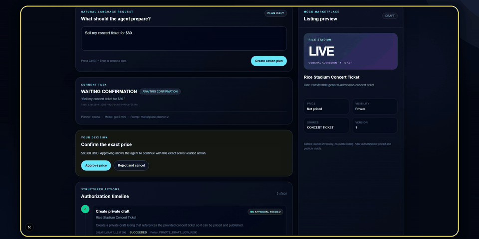
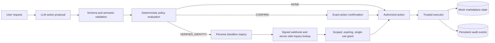

# VerifyAgent

**A policy-driven authorization and execution layer for AI agents.**

VerifyAgent addresses the boundary between an LLM proposing an action and an application allowing that action to change sensitive state. The Next.js service treats model output as untrusted, validates it against typed schemas and domain rules, applies deterministic server-side policy, and delegates approved work to a trusted executor backed by Prisma and SQLite. Persona Sandbox provides the higher-assurance identity step used by the demo's public-publishing action.

## Engineering highlights

- **LLM-to-execution boundary:** the OpenAI planner returns strict structured output with tools disabled; Zod validation, semantic checks, resource ownership checks, and action compilation run independently before anything is persisted as executable work.
- **Server-enforced authorization:** a versioned policy table assigns `NONE`, `CONFIRM`, or `VERIFIED_IDENTITY`; the runner reloads persisted state and re-evaluates ownership, dependencies, and resource state before authorization.
- **Scoped identity grants:** Persona-backed grants are bound to the user, session, action ID, action type, and canonical payload hash. They expire in at most 10 minutes and are consumed once with a compare-and-update check.
- **Transactional database execution:** the executor claims an action with a conditional update, then commits dependency checks, mock-marketplace mutation, grant consumption, result, and audit events in one database transaction. Request/action idempotency and listing version checks limit duplicate or concurrent mutations.
- **Verified server callback:** Persona webhook signatures are checked against the untouched request body; approved events also require an authoritative inquiry lookup and reference-ID match. Duplicate, delayed, terminal, and out-of-order events fail closed or are handled idempotently.

## Demo

The policy allows low-risk work with `NONE`, pauses exact-value changes for `CONFIRM`, and requires `VERIFIED_IDENTITY` before public actions. This preview shows the price confirmation and identity escalation; it ends while the server is waiting for Persona's signed webhook, not after final publishing.



## Architecture



The browser, user-supplied JSON, and model output are untrusted inputs. API routes derive the demo user and session on the server; callers cannot provide their own authorization level or execution state. Only the executor dispatches marketplace handlers, and it accepts persisted actions in the `AUTHORIZED` state rather than arbitrary model output.

Confirmation and identity approval are scoped differently. Confirmation stores the exact payload hash reviewed by the user. Identity verification creates a separate short-lived grant only after the signed Persona event and authoritative lookup agree with the pending action; the executor validates and consumes that grant again at mutation time.

## Demo workflow

The included workflow converts `Sell my concert ticket for $80.` into three typed actions:

| Action | Requirement | Demonstrated behavior |
| --- | --- | --- |
| `CREATE_DRAFT_LISTING` | `NONE` | Creates a private draft after policy evaluation |
| `SET_LISTING_PRICE` | `CONFIRM` | Pauses until the user approves the displayed $80 payload |
| `PUBLISH_LISTING` | `VERIFIED_IDENTITY` | Remains blocked until Persona-backed authorization is issued |

The deterministic success demo ends with a `$80 USD` listing in `PUBLISHED` state and a consumed identity grant. The failure demo processes a declined, duplicated Persona-shaped event and leaves the listing private with no grant.

## Testing and reliability

The current suite contains **126 automated tests across 26 test files**. The repository's full offline release gate passed on October 27, 2026, covering:

- strict action schemas, planner output validation, ownership, dependency, and price checks;
- all three policy levels plus denial contexts and exact-payload confirmation;
- grant scope, expiration, revocation, one-time consumption, replay, and concurrency behavior;
- Persona signature verification, authoritative lookup, changed payloads, duplicate and out-of-order events, and terminal failure states;
- executor rollback, optimistic concurrency, idempotency, state transitions, safe API contracts, redaction, headers, migrations, and seed data.

| Command | Purpose |
| --- | --- |
| `pnpm test` | Run the Vitest unit, contract, and integration suite |
| `pnpm run release:verify` | Run migrations, seed, diagnostics, lint, typecheck, tests, production build, both offline demos, and final reset |
| `pnpm run doctor` | Validate local configuration and database readiness without network calls |
| `pnpm run doctor -- --live` | Add one bounded real OpenAI structured-output check |
| `pnpm demo:success` / `pnpm demo:failure` | Exercise deterministic offline success and fail-closed paths |

`release:verify` does **not** contact OpenAI or Persona. The live doctor check covers OpenAI only; Persona Sandbox verification has side effects and is intentionally validated with the [real-sandbox runbook](docs/real-sandbox-runbook.md).

## Quick start

Requires Node.js 22.5+ and pnpm.

### Offline / mock mode

```bash
pnpm install
```

Create `.env` from `.env.example`, then use this minimal profile:

```dotenv
DATABASE_URL="file:./dev.db"
DEMO_MODE="true"
DEMO_PROFILE="offline-success"
APP_BASE_URL="http://localhost:3000"
LLM_PROVIDER="fake"
```

```bash
pnpm db:migrate
pnpm db:seed
pnpm dev
```

Open [http://localhost:3000](http://localhost:3000). The fake planner is restricted to demo mode and tests; no external credentials are required.

### Optional real OpenAI planner

Set `LLM_PROVIDER="openai"`, `LLM_API_KEY`, and `LLM_MODEL`, then run `pnpm run doctor -- --live`. Keys remain server-side and must not use a `NEXT_PUBLIC_` prefix.

### Optional Persona Sandbox

Set the server API key, webhook secret, environment ID, template ID, and API version described in the [real-sandbox runbook](docs/real-sandbox-runbook.md). Local webhook delivery requires a current HTTPS tunnel to `/api/webhooks/persona`; the browser application can remain on localhost.

## Scope and limitations

- This is a hackathon prototype with a mock marketplace, a fixed demo identity, and no production authentication deployment.
- Persistence uses a single SQLite database. It has not been load-tested or designed for distributed execution.
- Database transactions cover the included marketplace mutation, grant state, result, and audit rows. They do not provide atomicity for future external side effects such as a real marketplace API call.
- Persisted task states allow calls to resume after confirmation or identity waits, but there is no automatic lease or recovery mechanism for a process interrupted while an action is `EXECUTING`.
- Audit events are persistent and application code appends them alongside state changes; the database does not make them immutable or tamper-evident.
- Persona integration targets Sandbox. It demonstrates the authorization boundary but is not an independently validated production identity deployment.

## Additional documentation

- [Real OpenAI and Persona Sandbox runbook](docs/real-sandbox-runbook.md)
- [Live judge demo and deterministic fallback](docs/demo-runbook.md)
- [Release and security checklist](docs/release-checklist.md)
